<div align="center">

# Pathlight

**Know when the counter queue is losing you sales, with the Ring cameras you already own.**

Maya runs a café with Ring cameras over the door and the counter. At lunch the queue at the counter backs up toward the door, and some people
leave before they order. Her cameras record it, but they can't tell her it's happening, how often, or whether moving
the pastry display helped. Pathlight can. It puts every Ring visit on her floor plan, alerts her when the counter
queue passes her limit, tells her when to open a second register, and shows whether a layout change shortened the
wait. No new cameras, installer or calibration.

[](https://youtu.be/VIDEO_ID) [](https://github.com/Husky-AI9/SpatialGuard/actions/workflows/spatialguard-ci.yml) [](https://pathlight.up.railway.app) [](#real-ring-data-from-real-cameras) [](#run-it-locally) [](#how-its-built-on-aws) [](#tests-and-ci) [](FRICTION_LOG.md) [](LICENSE)

[**Live app**](https://pathlight.up.railway.app) · [Test it as a judge](#testing-it-as-a-judge) · [Real Ring data](#real-ring-data-from-real-cameras) · [How it uses Ring](#how-it-uses-ring) · [Privacy](#privacy-ring-terms-and-human-control) · [Architecture](#how-its-built-on-aws) · [Run it locally](#run-it-locally) · [Submission checklist](#hackathon-submission)

### [▶ Watch the demo video](https://youtu.be/VIDEO_ID)

<a href="https://youtu.be/VIDEO_ID">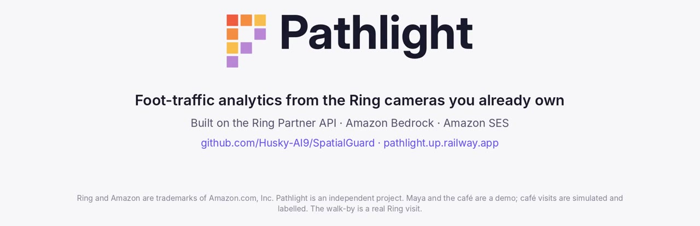</a>

</div>

## Testing it as a judge

> **Judges, start here.** Open **https://pathlight.up.railway.app** and sign in with the email and password from the
> Devpost **testing-instructions** field (they are not in this repository). Then follow the 9 steps below: Home heatmap
> → 3D → Analytics → Live only / All data → Weekly insight → alerts → Sites → a Live visit replay. About 5 minutes,
> nothing to install.

The judge account opens **Demo café**, a real coffee-shop floor plan (CC0) turned into a TwinForge twin:

- **Front door**, **Parking lot** and **Counter** are paired with real Ring cameras. Other map cameras are marked **SIM**.
- Two weeks of customers are simulated so the analytics have something to show. They are labelled **Simulated** everywhere.
- Visits from the real Ring cameras are labelled **Live**.
- The judge account is isolated: it can't reach the owner's Ring account, home or other places.

| # | Do this | You should see |
| --- | --- | --- |
| 1 | Sign in. **Home** opens on Demo café. | The café floor plan in **2D** with camera wedges and the business areas: entrance, counter, window bar, seating, lounge, parking. |
| 2 | Tap the **people** button on the map (**Show people heatmap**). Change the time span. | Where customers actually walk and wait. Counter and entrance glow brightest; corners stay cool. |
| 3 | Switch to **3D** and drag to orbit. | The same twin as an architectural model, with Ring hardware mounted on the walls. |
| 4 | Open **Analytics**. | Visits, peak hour and busiest zone; visits per day against last week, visits by hour, a busy-times grid, zones with average time spent, and entrances. |
| 5 | Toggle **Live only / All data**. Scroll to **Vehicles**. | Live only counts just the real Ring visits, including the week imported from Ring Event History. Vehicles counts Ring Smart Alerts `vehicle` events by hour, separately from visits. |
| 6 | Read **Weekly insight**. | A plain-English summary written by **Amazon Bedrock (Nova Pro)** from aggregate numbers only, with a line saying every figure was checked against the data. |
| 7 | Look at **Queue & crowding alerts → Recent alerts**. | A counter queue alert raised when the counter zone passed its limit. |
| 8 | Switch places with the **Sites** tabs in Analytics, then open **Settings → Places & floor plans**. | One account runs several places, each with its own twin, cameras and analytics. |
| 9 | Open **Activity** and pick a **Live** visit from the **Front door** camera. | The Ring recording plays beside the map while the detected path grows on the floor plan. |

| Label | Meaning |
| --- | --- |
| **Live** | From a physical Ring camera through the Ring Partner API: signed webhook, then recording, then the person's path |
| **Simulated** | Generated by demo mode so the café looks busy; no camera saw it |
| **SIM** camera | A map camera not yet paired with a Ring device |
| *Estimated* position | Derived from camera placement and field of view; not a calibrated measurement |

**If something looks off:** an empty map means picking **Demo café** in the top bar. "Ring is still preparing this
recording" clears after a minute. "AI insights aren't set up on this server" means the Bedrock key is missing on the
deployment. `/health` and `/status` on the hosted URL show whether the service is up.

## The problem: Maya's lunch rush

**Who:** Maya owns a small café with Ring cameras over the front door and the counter (the demo café adds one on
the parking lot). She is the owner in our demo video. The demo café's customers are simulated, apart from the
**Live** visits from the real Ring cameras.

**The moment:** Tuesday, 12:10. The line at the counter reaches the door. People glance at it and walk back out.
That's common: in a Bluedot survey of 1,576 U.S. adults, 77% said they will leave or consider leaving a restaurant
if they see a long line
([Nation's Restaurant News, 2021](https://www.nrn.com/family-dining/pandemic-intensifies-restaurant-wait-time-concerns-bluedot-survey-finds)).

**The cost:** if 6 people a day walk out of a $7 order, that's about $42 a day, or roughly $1,300 a month
(6 × $7 × 30 = $1,260). *These are example figures to show the stakes, not measurements.*

**Why her cameras can't help today:** Ring tells her what happened at the door. It can't tell her where people
wait, how long the queue gets or when it peaks. The usual answer is to buy dedicated people-counting hardware:

| | Figure | Source |
| --- | --- | --- |
| Ring cameras already installed | **More than 100 million** | [TechCrunch, March 2026](https://techcrunch.com/2026/03/31/ring-app-store-bets-on-ai-to-go-beyond-home-security/) |
| Small businesses in the U.S. | **36.2 million** | [SBA Office of Advocacy, 2025](https://advocacy.sba.gov/?p=30239) |
| A 3D people-counting sensor | **$300–$1,200 per door** (most $650–$1,200) | [SMS Storetraffic price guide, 2026](https://storetraffic.com/people-counting-guide/) (vendor) |
| Running a cable to power it | **$150–$400 per cable drop** | same guide |
| People-counting software | **$0 to about $150 per location, per month** | same guide |
| A thermal counter on subscription | **$300 per sensor, plus $135–$150 a month per sensor** | [Dor, 2026](https://www.getdor.com/blog/2026/06/16/people-counter-for-retail-store/) (vendor) |
| New hardware for Pathlight | **$0**: it uses the Ring cameras already on the wall | |

Counter prices are the vendors' own published figures. No public figure says how many small businesses run Ring,
but Ring is now expanding from homes into business security, and a door counter only counts entries: it can't show
where in the room the queue forms.


**What Pathlight does with the same two cameras:**

1. **It notices.** Each Ring motion event becomes a visit on her floor plan. When the counter zone passes her limit,
   Pathlight shows *Queue building at Counter* in the app.
2. **It says what to do.** **Today's actions** turns the week's numbers into plain advice, such as *Shorten the wait
   at Counter: open a second register around 12 PM*, and names the figures it comes from.
3. **She makes a change.** She moves the pastry display so people stop browsing in the line.
4. **It shows whether it worked.** The layout-change card compares the week before the change with the days since,
   for each area of the café. In the demo's simulated weeks, the average counter wait drops by 15%.

Most camera analytics count motion at the door. Pathlight places each visit on the owner's own floor plan, and that
is what makes a counter queue zone and a before-and-after layout test possible.

**The rest of what Pathlight adds to Ring:**

| What a business needs | What Pathlight adds to Ring |
| --- | --- |
| See where people go | A people heatmap on the business's own floor plan, in 2D and 3D |
| Staff for the rush | Visits by hour, a busy-times grid and visits per day against last week |
| Keep queues short | Queue and crowding alerts per zone, live in the app |
| Test a change | The week before a floor-plan change vs. the days since, by area |
| Count the parking lot | Ring Smart Alerts `vehicle` events, by hour, kept apart from visits |
| Run more than one place | Several sites per account, each with its own twin, cameras and analytics |
| Understand the week | A plain-English note from Amazon Bedrock, with every figure checked |

Positions are estimates from where each camera hangs, and Pathlight labels them that way.

## At a glance

- **One owner, one costly moment:** a café's lunch queue. Pathlight raises a queue alert, says when to open a
  second register, and shows whether a layout change helped ([Maya's lunch rush](#the-problem-mayas-lunch-rush)).
- **Demo video:** [watch it on YouTube](https://youtu.be/VIDEO_ID): a real walk past two physical Ring cameras becomes
  one visit on the café's floor plan, then the heatmap, analytics and a weekly note from Amazon Bedrock.
- **Live app, nothing to install:** [pathlight.up.railway.app](https://pathlight.up.railway.app). The judge sign-in
  is in the Devpost testing-instructions field, not in this repository.
- **Real Ring data, end to end:** 3 physical Ring cameras on one linked account, 16 past events imported from Ring
  Event History, and one real recording turned into a 77-point path on the floor plan in 7.8 seconds on the hosted
  server ([see it](#real-ring-data-from-real-cameras)).
- **No calibration:** the owner drops each camera on the plan, aims it and says what it is. Positions come from
  published single-view geometry and are always shown as estimates ([the method](#the-innovation-positions-without-calibration)).
- **Private by design, owner in control:** paths are anonymous floor points, recordings are deleted after analysis,
  Bedrock only ever sees aggregate counts, and nothing acts on its own
  ([privacy and Ring terms](#privacy-ring-terms-and-human-control)).

| Try it | |
| --- | --- |
| **Hosted app** | https://pathlight.up.railway.app (web on desktop and phone) |
| **Judge sign-in** | Email and password in the Devpost **testing instructions** field |
| **Android** | Capacitor app built in CI from [`spatialguard/apps/web/`](spatialguard/apps/web/) |
| **Step-by-step testing** | [Testing it as a judge](#testing-it-as-a-judge), at the top of this page |

## Real Ring data from real cameras

The live visits come from three physical Ring cameras on one linked Ring account, not a simulator. These numbers were
measured on the hosted server:

| **3** | **16** | **7.8 s** | **77** |
| :---: | :---: | :---: | :---: |
| Ring cameras on one linked account | past events pulled from Ring Event History | from a real Ring recording to a finished path | floor points in that path |

**What happens to one real visit**

1. **Motion.** A customer passes the Front door camera, and Ring sends Pathlight a signed motion webhook
   (`ring_service.py`).
2. **Detection.** Pathlight downloads the clip and YOLO11n finds the person in each frame (`ring_provider.py`,
   `person_tracking.py`).
3. **Path.** Each foot point is projected onto the café floor plan, and then the recording is deleted (`tracks.py`).
4. **Hand-off.** When the Counter camera picks the same person up, the visit continues instead of starting over.
5. **Day one.** **Import last 7 days** runs past Ring Event History recordings through the same steps, so analytics
   start with real foot traffic.

<p align="center">
  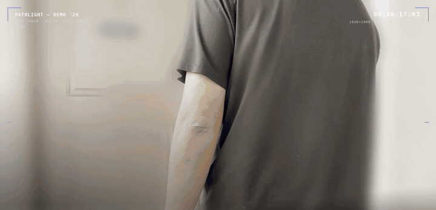
</p>

<p align="center">
  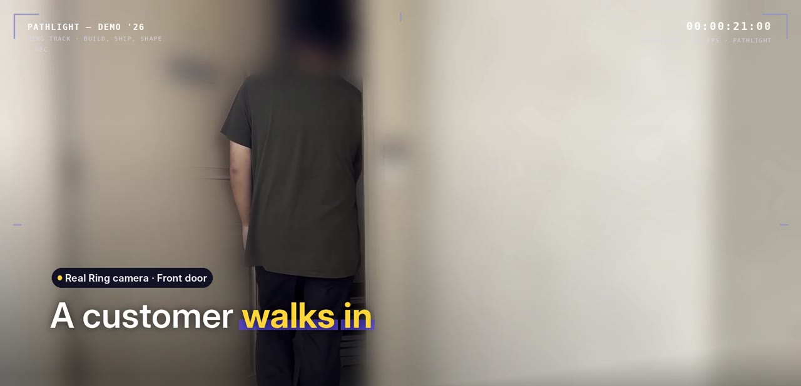
  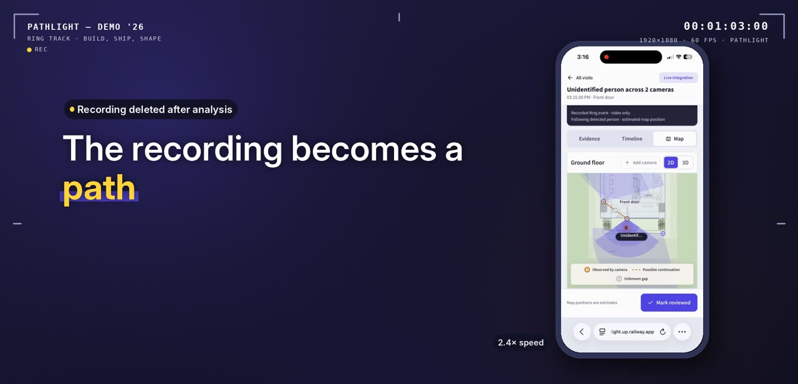
  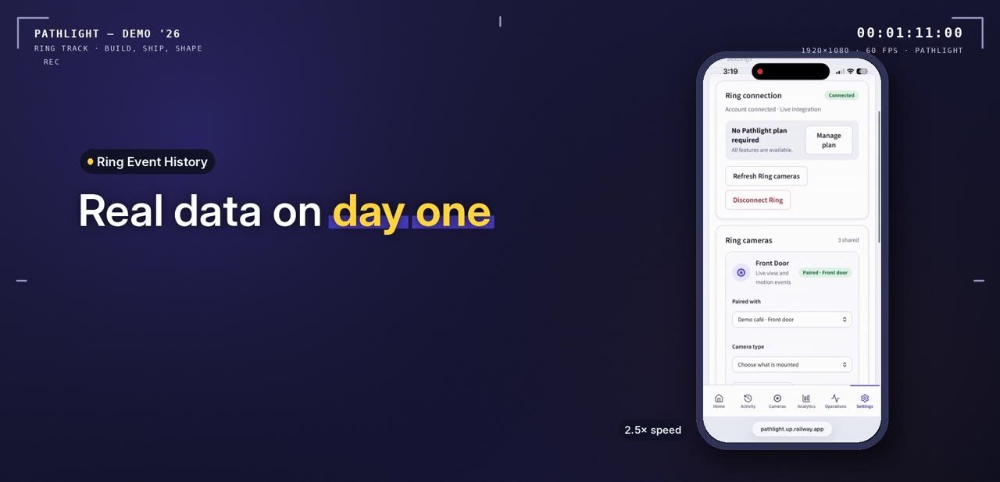
</p>
<p align="center"><sub>Left to right: the Front door camera during the test walk · that visit on the floor plan · the Event History import. Everything else in the café's two weeks is simulated and labelled <b>Simulated</b> in the app.</sub></p>

**Evidence in the repo:** [`verification.md`](spatialguard/docs/verification.md) (linking, inventory, snapshot, live
view, webhooks), [`hosted-ring-link-verification.md`](spatialguard/docs/hosted-ring-link-verification.md) (linking on
the hosted server) and [`recorded-incident-movement.md`](spatialguard/docs/recorded-incident-movement.md) (the
77-point path).

## What it does

- **Floor plan to twin.** Upload a PNG/JPEG floor plan. TwinForge traces rooms and doors into an editable 2D/3D model, with optional Amazon Bedrock vision that ignores furniture. You confirm two real dimensions before anything is published, and every published layout is an immutable revision.
- **Cameras on the map.** Place each Ring camera where it hangs and aim it. Pairing links the map camera to an authorized Ring device, and the owner picks its type (video doorbell, Stick Up Cam or another Ring camera), because Ring's API doesn't report one.
- **People heatmap.** Every visit becomes floor positions, and the heatmap shows where people actually walk and stop over a chosen time span.
- **Site analytics.** Visits per day against last week, visits by hour, a busy-times grid, zones with average time spent, and entrances. Real Ring visits and simulated demo visits can be counted separately (**Live only / All data**).
- **Layout change impact.** Compare the week before a floor-plan change with the days since, for example the counter wait after moving the pastry display.
- **Vehicles.** Ring Smart Alerts `vehicle` events are counted as cars by hour (the parking lot), separately from visits. No plates or images are kept.
- **Weekly insight.** Amazon Bedrock writes a short summary from aggregate numbers only. Every note is checked before it is shown: each figure must match the data, a block list catches anything about who visitors are, and a failed note is replaced by a plain one.
- **Queue and crowding alerts.** Zones named like "Counter" or "Checkout" raise an alert when they pass their limit.
- **Property management.** Several places per account, with one analytics view per site, plus data export and deletion.
- **Visit replay.** Open a real Ring visit to play the Ring recording beside the map while the detected path grows on the floor plan.

### Inside the app

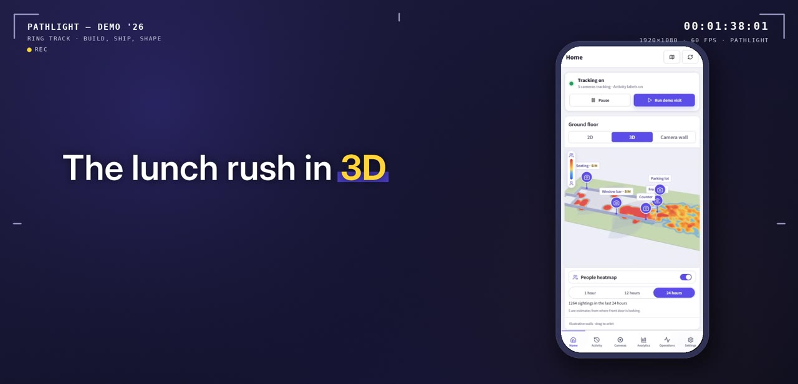

#### Heatmap in 2D or 3D
Every visit adds floor points to the twin. Pick a time span and see where people walk and wait. The counter and
entrance glow brightest, and the corners stay cool.

<br clear="right">

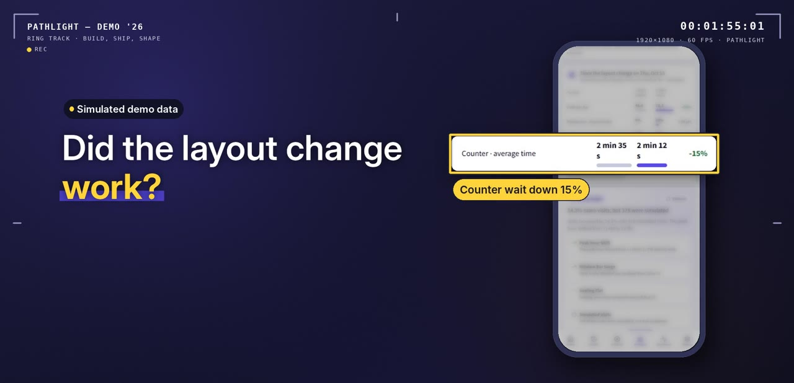

#### Did the layout change work?
Pathlight compares the week before a floor-plan change with the days since. In the demo café's,
moving the pastry display cut the average counter wait by 15%.

<br clear="left">


#### A checked weekly note
Amazon Nova on Bedrock writes a short note from aggregate counts only. Pathlight checks every figure against the data
and says nothing about who the visitors are, then marks the note **Checked**.

<br clear="right">

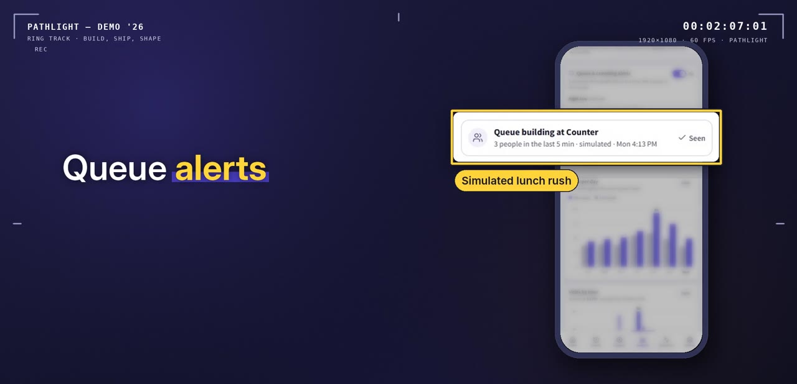

#### Queue alerts
Zones named like "Counter" or "Checkout" have a limit that the owner sets. When the queue passes it, an alert appears
live in the app and in Site Analytics.

<br clear="left">

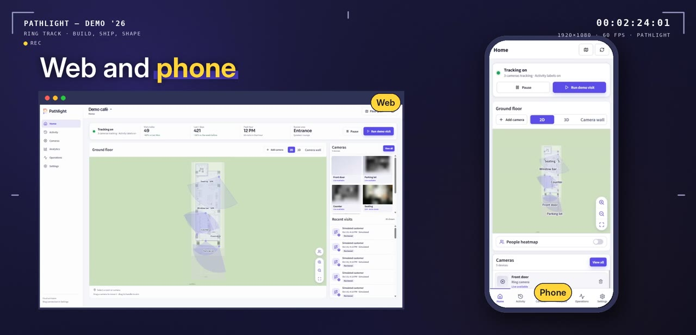

#### Cars counted on their own
Ring Smart Alerts mark `vehicle` events. Pathlight counts them by hour as parking-lot traffic and never adds them to
visits. No plates or images are kept.

<br clear="right">

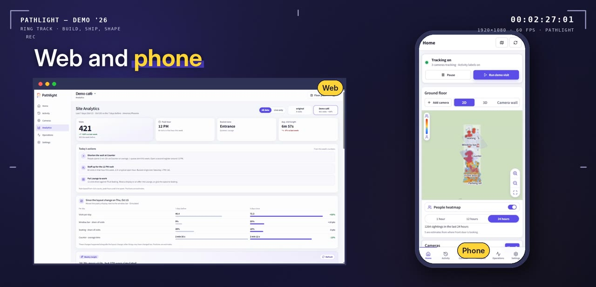

#### Every site, web or phone
One account runs several places, each with its own twin, cameras and analytics, in the browser or the Android app.

<br clear="left">

**Honest by design:**
- Positions are estimates from the camera's placement and field of view, not calibrated measurements.
- Paths are anonymous floor points: no faces, no identity, and no link between visits or accounts.
- Foot-traffic analysis is a separate, off-by-default permission, and each recording is deleted after analysis.
- Simulated demo data is labelled **Simulated** everywhere.

## The innovation: positions without calibration

Camera analytics normally needs each camera calibrated: an installer, reference points, measuring. Pathlight skips
that step. The owner drops each Ring camera on their floor plan where it hangs, aims it, and says what it is.
Pathlight then estimates floor positions from those priors:

- each detected person's foot point,
- a linear angle-per-pixel bearing across the lens's field of view (the equidistant wide-angle model),
- a near/far cue from where the feet meet the floor.

Every position is shown as an estimate with an uncertainty footprint. This builds on established single-view
geometry and monocular localization work: the foot point as the ground position (Hoiem et al., IJCV 2008; Rezaei &
Azarmi, 2020), ground-plane positions from an uncalibrated image (Criminisi et al., IJCV 2000; Aghaei et al., WACV
2021), the equidistant lens model (Kannala & Brandt, TPAMI 2006) and uncertainty-aware single-camera localization
(Bertoni et al., ICCV 2019). The upgrade path is self-calibration from the visitors themselves (Krahnstoever &
Mendonça, ICCV 2005). Full method, references and limits:
[`position-estimation.md`](spatialguard/docs/position-estimation.md).

## How it uses Ring

All Ring calls go to the official **Ring Partner API** from the server. Tokens never reach the browser or the
Android app.

| Ring capability | Endpoint / mechanism | Where in code |
| --- | --- | --- |
| One-way account linking and token exchange | Ring Appstore link with nonce, `POST https://oauth.ring.com/oauth/token`, `GET /v1/users/me`, `POST/PATCH /v1/accounts/me/app-integrations` | `ring_gateway.py`, `ring_service.py`, `ring_provider.py` |
| Authorized device inventory, status, capabilities | `GET /v1/devices?include=…` | `ring_service.py` |
| Signed webhooks (motion, button press, lifecycle) | HMAC-SHA256 `X-Signature` over the raw body, durable inbox, dedupe, bounded retries | `ring_service.py` (`webhook`), `ring_worker.py` |
| Snapshots | `POST /v1/devices/{id}/media/image/download` → pre-signed redirect | `ring_provider.py` (`snapshot`) |
| Recorded clips for visit paths | `POST /v1/devices/{id}/media/video/download` → OpenCV 5 + YOLO11n person detection → floor points | `ring_provider.py` (`clip`), `tracks.py`, `person_tracking.py` |
| Live view | WebRTC WHEP `…/media/streaming/whep/sessions`, bounded, video only | `ring_provider.py` (`stream`) |
| Event History backfill | `GET /v1/history/devices/{id}/events` → the same inbox and clip pipeline as webhooks | `ring_service.py` (`import_history`) |
| Smart Alerts subtypes | `sub_type` on motion webhooks: `vehicle` is counted as a vehicle, everything else is analyzed | `ring_worker.py`, `analytics.py` |
| Video encryption check | `e2e_encryption.enabled` in device configurations, read before any video processing | `ring_service.py` |
| Subscriptions | `GET /v1/accounts/me/subscriptions` | `ring_service.py` |

All files above are in [`spatialguard/services/api/spatialguard_api/`](spatialguard/services/api/spatialguard_api/).
Verified with real hardware: account linking, inventory, a snapshot, a 1280×720 live view, signed lifecycle
webhooks, and a motion event whose recording was analyzed into a 77-point path. How Pathlight meets Ring's Computer
Vision Guidelines is in [`ring-cv-guidelines.md`](spatialguard/docs/ring-cv-guidelines.md).

## Privacy, Ring terms and human control

Pathlight looks at people on camera, so here is exactly what it keeps, what it never does, and where the owner
decides.

**What it stores**

- For each visit: anonymous floor points with times and zones. No faces, no clothing or colour, no identity, and no
  link between visits, places or accounts.
- Vehicle counts by hour, queue and crowding alerts, and the weekly note.
- Recordings are written to scratch space only while the person detector runs, then deleted.
- Everything follows the owner's retention setting. Deleting a visit, a place or the account removes its visits,
  paths, analytics, alerts and insights. **Disconnect Ring** stops all Ring processing.

**What it never does**

- Recognise faces or identify anyone.
- Follow a person from one visit, day or place to the next.
- Send images to Amazon Bedrock for the weekly note. The model sees only aggregate counts, and its text is checked
  against the data before anyone sees it.
- Act on its own. Alerts and **Today's actions** are suggestions for the owner. Nothing changes staffing, contacts
  anyone or controls a device. Pathlight is not a security or life-safety system.

**Where the owner decides**

- **Foot-traffic analysis** is a separate permission and is off by default. Until the owner turns it on, no
  recording is downloaded for analysis.
- The owner sets each zone's queue or crowding limit and the time window, or turns alerts off. Queue alerts appear
  in the app, not by email or text, and a zone doesn't alert again while an alert from the last 15 minutes is still
  unacknowledged.
- Email is opt-in. The only alert emails are camera offline/recovered notices, sent to an address the owner enters.
- Cameras with Ring video encryption are counted but never analyzed.

**Ring's terms**

- Pathlight uses the official Ring Partner API with the owner's authorization, through Ring's one-way account
  linking. Ring tokens stay on the server, encrypted, and never reach the browser or the Android app.
- Ring's Content Policy 1.2.4 doesn't allow collecting, mapping or deriving personal data about people on video
  without explicit consent. Pathlight's approach: the owner opts in, paths are anonymous floor points, recordings
  are deleted after analysis, and onboarding asks the owner to tell visitors that cameras are in use.
- How Pathlight meets each of Ring's Computer Vision Guidelines is mapped, with code and tests, in
  [`ring-cv-guidelines.md`](spatialguard/docs/ring-cv-guidelines.md).
- **Status:** this preview runs as a private Ring app. It has not yet been submitted for Ring Appstore
  certification, and asking Ring to confirm the foot-traffic use case in writing is part of that plan
  ([`ring-appstore-review.md`](spatialguard/docs/ring-appstore-review.md)).

**What an owner should do:** put up a notice that cameras are in use, as onboarding asks, and follow local rules on
recording and notice. Pathlight is offered in the US only.

## How it's built on AWS

| Piece | AWS service | Code |
| --- | --- | --- |
| Weekly site insight, from aggregate numbers only | **Amazon Bedrock**, Converse API, Amazon Nova Pro (`us.amazon.nova-pro-v1:0`) | `spatialguard_api/insights.py` |
| Floor-plan vision: rooms and doors as JSON, validated by TwinForge | **Amazon Bedrock**, Nova Pro (multimodal) | `services/api/twinforge/vision_plan.py` |
| Optional cautious activity labels for opted-in snapshots | **Amazon Bedrock**, Nova Pro | `spatialguard_api/classifier.py` |
| Account verification, password reset and opt-in camera offline/recovered email | **Amazon SES** (v2 API via boto3; Railway Hobby blocks SMTP) | `spatialguard_api/mail.py` |

Bedrock is called over HTTPS with a Bedrock API key (`AWS_BEARER_TOKEN_BEDROCK`) from the Railway-hosted server. If
it isn't configured, each feature says so in the app rather than failing silently.

<p align="center">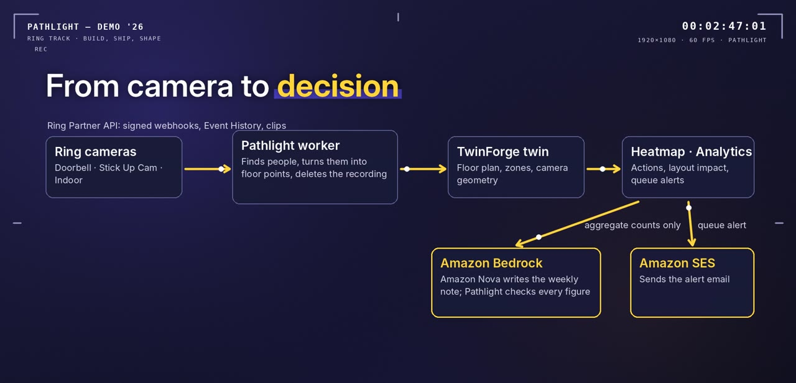</p>

```text
 Ring Partner API ──webhooks / media──▶  Pathlight API + worker  ──HTTP SDK──▶  TwinForge engine
 (oauth.ring.com,                       (FastAPI, SQLite WAL,                  (floor-plan twin:
  api.amazonvision.com)                  YOLO11n via OpenCV)                    immutable revisions,
                                                │                               rooms, zones, cameras,
 Amazon Bedrock (Nova Pro) ◀──insight, labels───┤                               spatial queries,
 Amazon SES ◀──email────────────────────────────┤                               provenance)
                                                ▼
                                   React web app / Android (Capacitor)
                                   2D/3D map · heatmap · analytics · alerts
```

Pathlight never opens TwinForge's database; it uses TwinForge's public API and SDK, and a test enforces that boundary
([`test_architecture_boundary.py`](spatialguard/tests/test_architecture_boundary.py)). Ring-specific code lives only
in Pathlight.

# Pathlight: Accuracy Test Results

## Results

### Visit Counting

| Metric                      | result     | Sample size |
| :-------------------------- | :----------------- | ----------: |
| Manually counted walk-bys   | 20                 |   20 passes |
| Visits counted by Pathlight | 19                 |   20 passes |
| Visit-count error           | −1 visit (−5%)     |   20 passes |
| Correctly matched visits    | 19 / 20 (95%)      |   20 passes |

### Floor Position

| Metric                         | result | Sample size |
| :----------------------------- | -------------: | ----------: |
| Floor-position test points     |             20 |   20 points |
| Mean position error            |         0.42 m |   20 points |
| Median position error          |         0.35 m |   20 points |
| 90th-percentile position error |         0.78 m |   20 points |

---

## Run it locally

The **hosted app is the easiest way to evaluate** (see [Testing it as a judge](#testing-it-as-a-judge)). To run it
yourself:

### Option A: Docker (the path CI runs)

```sh
git clone https://github.com/Husky-AI9/SpatialGuard.git
cd SpatialGuard
docker build -t pathlight .
docker run --rm --network host \
  -e SPATIALGUARD_ALLOWED_HOSTS=127.0.0.1:8010 \
  -e SPATIALGUARD_ORIGIN=http://127.0.0.1:8010 \
  -e PATHLIGHT_DEMO_ACCOUNTS=local \
  pathlight
```

Open http://127.0.0.1:8010. The local owner session opens automatically from `127.0.0.1`. Then load the demo café in
a second terminal (standard library only):

```sh
python spatialguard/scripts/demo_cafe.py --local
```

In the app, open **Settings → Demo mode → Create two simulated weeks**, then **Home** (map and heatmap) and
**Analytics**.

### Option B: Python and Node directly

Requires Python 3.11 and Node 22 (`.python-version`, `.nvmrc`).

```sh
python -m venv .venv && . .venv/bin/activate      # Windows: .venv\Scripts\Activate.ps1
pip install -r requirements.lock
npm ci
npm run build --workspace spatialguard-web

export PYTHONPATH=services/api:packages/sdk-python:spatialguard/services/api   # PowerShell: $env:PYTHONPATH="services/api;packages/sdk-python;spatialguard/services/api"
export PATHLIGHT_DEMO_ACCOUNTS=local
python -m twinforge.cli init                       # creates .data/ and the engine credential
python -m uvicorn twinforge.api:create_app --factory --port 8000 &
python -m twinforge.worker &
python spatialguard/scripts/run.py                 # API :8010, Ring gateway :8011, worker
```

These are the same processes `spatialguard/scripts/container-start.sh` starts in the container.

### Optional configuration

Copy `.env.example` to `.env`, or set Railway Variables:

- `AWS_BEARER_TOKEN_BEDROCK` and `AWS_REGION`: weekly insight, floor-plan vision and activity labels.
- `RING_CLIENT_ID`, `RING_CLIENT_SECRET` and `RING_WEBHOOK_SECRET`: a Ring private app. Point its four URLs at `/ring/link`, `/ring/home`, `/ring/token` and `/ring/webhook`.
- `SPATIALGUARD_TOKEN_KEY`: a Fernet key that encrypts stored Ring tokens on Linux.
- `SPATIALGUARD_SES_*` / `SPATIALGUARD_SMTP_*`: email.

Hosted deployment details: [`RAILWAY_DEPLOYMENT.md`](spatialguard/RAILWAY_DEPLOYMENT.md).

## Tests and CI

```sh
python -m pytest spatialguard/tests -q            # 177 backend tests: Ring webhooks/media, analytics, heatmap, privacy, tenancy
npm run test --workspace spatialguard-web         # 48 Playwright browser tests (needs the app on :8010)
```

The GitHub Actions workflow ([`spatialguard-ci.yml`](.github/workflows/spatialguard-ci.yml)) runs the backend tests,
builds the Docker image and runs the browser suite against it. It also checks contract drift, builds the Android debug
app, and runs `npm audit`, `pip-audit`, `bandit`, license collection and `gitleaks` across the full history.

## Repository map

| Path | What |
| --- | --- |
| `spatialguard/services/api/spatialguard_api/` | Pathlight API, worker, Ring integration, analytics, heatmap, alerts, insights |
| `spatialguard/apps/web/` | React app (web) and its Capacitor Android/iOS shells |
| `spatialguard/apps/expo-go/` | Expo Go mobile preview of the hosted app |
| `services/api/twinforge/` | TwinForge floor-plan twin engine (geometry, revisions, plan tracing) |
| `packages/` | Shared contracts, Python/TypeScript SDKs, 2D/3D view geometry |
| `spatialguard/tests/` | Backend tests |
| `spatialguard/docs/` | Verification records, Ring Appstore review notes, runbooks |
| `spatialguard/models/` | YOLO11n ONNX person detector (AGPL-3.0, see below) |
| `docs/images/readme/` | Images used in this README, taken from the demo video |

> The repository and code namespaces are still called **SpatialGuard** (`spatialguard/`, `spatialguard_api`). The
> floor-plan twin engine is **TwinForge** (`services/api/twinforge`). Pathlight is the product built on both.

## Limits

- Positions are calibration-free estimates (see [position estimation](spatialguard/docs/position-estimation.md)). A wrong heading or range shifts a camera's positions consistently, so treat paths and heatmaps as directional.
- The detector follows one primary person per recording; it is not a multi-person identity tracker.
- Any map camera without a Ring device is labelled **SIM**.
- Event History import is capped at the last 7 days and 40 events per camera. Ring decides which past recordings are still available, and a visit without a recording is counted with an estimated position.
- Cameras with Ring video encryption are counted but never analyzed, so they add no paths.
- The hosted preview uses SQLite on a mounted volume, with one replica.
- Ring Appstore certification has not been submitted yet. The draft reviewer notes are in [`ring-appstore-review.md`](spatialguard/docs/ring-appstore-review.md).

# Pathlight: One-Week Restaurant Pilot Feedback

This document summarizes feedback from two restaurants that piloted Pathlight for one week each.

## Pilot Restaurant 1: Adam Kitchen

**Pilot Duration:** One week

### What They Liked

- The heatmap made it easy to identify areas where customers frequently gathered around the ordering counter.
- The activity timeline revealed recurring peak periods, helping staff better understand customer traffic patterns.
- Using existing compatible cameras offered a cost-effective alternative to purchasing dedicated analytics hardware.

### What They Disliked

- Heatmaps showed where congestion occurred but did not yet provide enough recommendations for staffing adjustments or opening additional registers.
- Overlapping customers and people lingering near the counter occasionally made queue estimates less reliable.
- The owner wanted a simpler daily summary with key findings and actionable recommendations instead of having to interpret the full dashboard.

### Owner Feedback

> "I can see the potential, especially for understanding our rush periods. If it can help us anticipate busy times and make better staffing decisions, I can see us using this regularly."

### Would They Continue Using Pathlight?

**Yes.** The owner would continue using Pathlight because the heatmaps and activity timeline provided useful visibility into customer traffic.

---

## Pilot Restaurant 2: La Rancho Café

**Pilot Duration:** One week

### What They Liked

- The bird's-eye view made customer movement easier to understand than reviewing individual camera feeds.
- Visualizing movement between the entrance, ordering counter, and seating areas helped identify potential bottlenecks and opportunities to improve the layout.
- Combining multiple camera views into one interface made it easier to understand activity throughout the café.

### What They Disliked

- Visitor counts could be confusing when customers overlapped or moved between camera coverage areas.
- The owner wanted clearer explanations of the privacy safeguards and a simpler way to understand the business value of the analytics.

### Owner Feedback

> "The overhead map is the feature that really stands out. I would like to keep using it to understand how customers move through the café. As the accuracy improves and the reports become easier to use, I can see this becoming a valuable tool for our business."

### Would They Continue Using Pathlight?

**Yes.** The owner would continue using Pathlight because the consolidated bird's-eye view offered insights that were difficult to obtain from individual camera feeds. Improving positioning accuracy, simplifying visitor counting, and providing concise reports would make the system even more useful for ongoing layout and operational decisions.

---

## Summary

| | Adam Kitchen | La Rancho Café |
|---|---|---|
| **Standout feature** | Heatmap and activity timeline | Bird's-eye view across cameras |
| **Main pain point** | Unreliable queue estimates; no staffing recommendations | Floor-position accuracy; confusing visitor counts |
| **Top request** | Simple daily summary with actionable recommendations | Clearer privacy explanations and simpler reports |
| **Would continue?** | Yes | Yes |

## Hackathon submission

Build, Ship, Shape: Amazon Developer Hackathon 2026.

| Rule | Where it's met |
| --- | --- |
| **Track: Ring**. Any Ring API, SDK, simulator or device | The Ring Partner API, called at runtime from the server ([How it uses Ring](#how-it-uses-ring)) |
| Demo shows the project working through a simulator or an actual Ring device | Three physical Ring cameras on a real linked account ([Real Ring data from real cameras](#real-ring-data-from-real-cameras)) |
| **Mini challenge: AWS Builder**. AWS services with documented integrations | Amazon Bedrock (Nova Pro) and Amazon SES ([How it's built on AWS](#how-its-built-on-aws)) |
| Setup and run instructions | [Run it locally](#run-it-locally) |
| Testing instructions and judge access | [Testing it as a judge](#testing-it-as-a-judge); sign-in in the Devpost testing-instructions field |
| Friction log (optional) | [FRICTION_LOG.md](FRICTION_LOG.md): 13 dated Ring entries, each with task, steps, expected vs. actual, severity, workaround and suggestion, plus feature requests |
| Open source license | [MIT](LICENSE) |
| Demo video: under 3 minutes, public on YouTube | [Watch the demo](https://youtu.be/VIDEO_ID) |

**Built during the hackathon.** The submission period runs from August 31 to October 23, 2026. The TwinForge spec was
written on September 13, 2026, and the first application commit is from September 20, 2026. All Ring, AWS,
analytics, heatmap and mobile work happened during the submission period.

**Third-party software and data.** Person detection uses Ultralytics YOLO11n, exported to ONNX and licensed AGPL-3.0
([`YOLO-LICENSE.txt`](spatialguard/models/YOLO-LICENSE.txt)), not MIT. The demo café floor plan is CC0 (OpenCAD
Library). Fonts ship under their bundled licenses. Ring and Amazon are trademarks of Amazon.com, Inc. or its
affiliates. Pathlight is an independent hackathon project and is not made or endorsed by Ring or Amazon.

## License

Pathlight's code is released under the [MIT License](LICENSE). The YOLO11n model file
(`spatialguard/models/yolo11n.onnx`) is AGPL-3.0.
